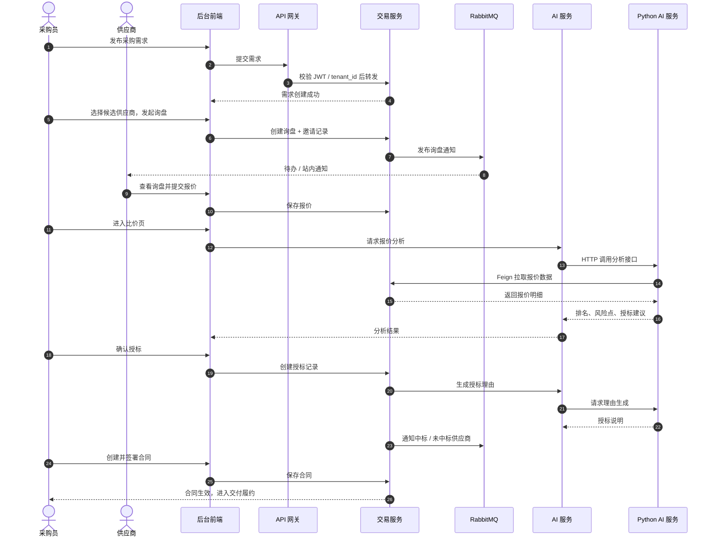
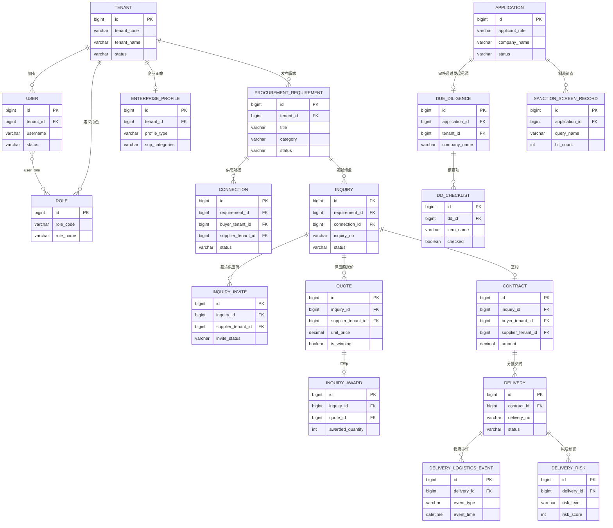

# Vanpine-SCM · 全球供应链 AI 赋能平台

> 赋能地方资源 · 连接全球市场

一个面向跨境采购的 **B2B 供应链协同平台（SCM）**：采购方在平台上发布采购需求，平台用 AI 从供应商库中匹配候选并给出评分理由；双方在线询盘、比价、电子签约；签约后系统持续追踪交付、物流与风险，并把制裁名单、股权关系、地缘与天气等外部信号接入到每一笔交易里。

**一句话**：企业不用再靠人脉找供应商、靠 Excel 管报价、靠邮件催交付，整条采购链路在一个平台里完成并留痕。

## 项目速览

| 维度 | 说明 |
|---|---|
| 项目类型 | B2B 跨境供应链协同平台（Glboal SCM） |
| 业务闭环 | 入驻审核 → 供应商画像 → 智能匹配 → 询盘报价 → 比价授标 → 电子合同 → 交付验收 → 风险监控 |
| 服务对象 | 采购企业、供应企业、第三方尽调机构、平台运营方、承运商 |
| 系统形态 | 后台管理系统 + Java 微服务后端 + Python AI 服务 |
| 核心难点 | 多租户数据隔离、多角色权限模型、AI 与业务流程解耦、外部风险信号整合 |

## 解决什么问题

### 痛点一：供应商靠人脉找，资质靠人工核

传统跨境采购找供应商依赖展会、熟人推荐和 B2B 平台海量搜索，效率低且信息真假难辨；供应商的资质、产能、出口经验、财务状况散落在不同人的邮箱和聊天记录里。

**平台怎么做**：供应商入驻时结构化填写企业画像（品类、产能、资质、出口经验、财务与履约记录），平台审核后入库；采购方发布需求后，AI 对需求做语义解析，从画像库中向量召回候选供应商，再叠加品类、资质、产能、地域、出口经验等多维度评分排序，并**输出匹配理由**——告诉采购员"为什么推荐这家"，而不是只给一个分数。

### 痛点二：询价靠邮件和 Excel，报价难横向对比

采购员把询价单群发邮件，供应商用各自的 Excel 回填，格式不统一、版本满天飞；比价时只能一列列手工对齐，隐藏成本（运费、关税、付款账期）经常被漏算。

**平台怎么做**：需求一键生成结构化的多语言 RFP/RFQ 询价单，点对点分发给指定供应商；供应商在线报价，系统统一归集；比价模块做 TCO 全维度成本拆解、历史价格对标和异常报价识别，在多目标约束下推荐最优采购方案；授标环节由 AI 自动生成授标理由并归档。

### 痛点三：跨境合规风险只能事后补救

交易对手是否在制裁名单上、股权背后有没有敏感方、有没有未披露的诉讼——这些信息采购员很难逐条查证，往往出事后才发现问题。

**平台怎么做**：制裁名单实时比对，多层股权穿透追溯实际控制人与关联方，诉讼与行政处罚记录自动汇总；尽调任务可派单给第三方机构，机构在独立工作台提交报告；平台分钟级生成尽调报告，把"能不能和这家做生意"变成一个有据可查的结论。

### 痛点四：合同签完，交付就"失控"

签约只是开始。货有没有发、走到哪个港口、能不能按时到、天气和航线有没有风险——传统方式靠业务员定期追问，问题往往在交付延期后才暴露。

**平台怎么做**：把发货、物流轨迹、收货、验收串成可视化的履约链路，关键节点自动存证；结合天气与航线数据给出运输建议（如台风预警时提示调整航线或提前发货）；风险事件自动关联到具体供应商和订单，触发分级预警并推送应急处置方案（备选供应商、替代航线、调拨）。

### 痛点五：经验沉淀在个人手里，企业没有供应商资产

供应商评价、历史报价、履约表现只存在于业务员个人记忆中，人员流动即资产流失。

**平台怎么做**：每一次询价、报价、交付、评价都沉淀到供应商画像与履约记录中，形成企业级供应商资产；平台驾驶舱实时汇总交易与风控数据，让决策有数据支撑。企业内部通过租户 + 角色 + 数据权限隔离，既共享平台能力，又保证各企业数据不串号。

## 平台角色

平台采用**多租户 + RBAC** 模型：每个企业是一个租户，租户内自定义角色与菜单权限；平台级角色跨租户运营。共 7 类角色：

| 角色 | 标识 | 能做什么 |
|---|---|---|
| 采购商 | `BUYER` / `BUYER_ADMIN` | 发布采购需求、发起询盘、比价、授标、签约、验收；管理员可管理本企业用户与权限 |
| 供应商 | `SUPPLIER` / `SUPPLIER_ADMIN` | 完善企业画像、接收询盘、在线报价、确认订单、履约发货；管理员管理本企业成员 |
| 双重身份 | `BUYER + SUPPLIER` | 同一企业既采购也供应，注册时可同时勾选两种身份 |
| 企业管理员 | `TENANT_ADMIN` | 开通租户时的默认管理员，管理本租户的用户、角色、菜单 |
| 超级管理员 | `SUPER_ADMIN` | 审核入驻申请、管理租户、维护制裁名单、查看全局审计日志 |
| 尽调专员 | `DUE_DILIGENCE` | 只能访问尽职调查模块，处理尽调案件 |
| 尽调事务所 | `FIRM` | 第三方尽调机构，拥有独立工作台，接收派单并提交尽调报告 |

**权限实现**：JWT 携带 `tenant_id` 与角色列表，网关统一校验；服务层通过租户拦截器保证查询自动附加租户条件；前端按角色动态生成菜单并做路由守卫（如 `FIRM` 强制进入事务所工作台，尽调角色无法访问 AI 助手）。

## 核心功能

**1. 供应商入驻与认证** — 企业注册申请、资质材料上传、平台审核、租户隔离，支持采购商/供应商双角色。

**2. 供应商全域画像** — 企业基本信息、产品品类、产能、出口经验、认证资质、财务与履约记录形成结构化画像；画像文本向量化后进入向量库，供语义匹配调用。

**3. 智能供需匹配** — 采购需求发布后，AI 对需求做语义解析，向量召回候选供应商，再叠加品类、资质、产能、地域、出口经验、画像完整度等多维度评分排序，并**生成可读的匹配理由**。同时提供买卖双向广场，支持主动发现与直接对接。

**4. 尽职调查与合规筛查** — 制裁名单实时比对、多层股权穿透追溯实际控制人与关联方、诉讼与行政处罚记录自动汇总；尽调任务可派单给第三方机构，机构拥有独立工作台，分钟级生成尽调报告。

**5. 采购交易全链路** — 采购需求 → 询盘邀请 → 结构化 RFP/RFQ 生成 → 报价归集 → 多维度比价（TCO 成本拆解、异常报价识别）→ 授标（AI 生成授标理由）→ 电子合同签署 → 履约跟踪。

**6. 交付与物流履约** — 发货、收货、验收三段管理，物流轨迹追踪，关键节点自动存证，并结合天气数据给出运输建议（如台风预警时提示调整航线或提前发货）。

**7. 供应保障驾驶舱** — 聚合在途订单与供应商运行状态，风险事件自动关联到具体供应商与航线，触发分级预警，并支持应急处置推演：备选供应商、替代航线、调拨方案。

**8. 平台治理** — 多租户管理、用户/角色/菜单权限、审计日志、文件服务、消息通知、支付回调。

## 采购到签约流程



## 核心数据模型



> 以上为核心链路实体，实际库表还包括权限、菜单、通知、AI 对话与知识库、尽调附件等辅助表。

## AI 能力

AI 服务独立部署，负责"计算与生成"，业务数据由后端通过内网接口提供。

| 能力 | 说明 |
|------|------|
| 供应商画像向量化 | Embedding API + Milvus，按 `tenant_id` 隔离写入 |
| 需求语义匹配 | 向量召回 + 规则引擎多维打分 + 理由生成 |
| 报价分析 | 综合排名、风险识别、授标建议 |
| 授标理由生成 | 对比中标报价与其他报价，自动成文 |
| 询盘内容辅助 | 按品类推荐规格模板、付款条件、交期建议 |
| 供应风险预判 | 多因子风险打分，输出风险描述 |
| 库存预警 | 消耗速率预测，提前提示补货 |
| 运输天气建议 | 航线天气查询 + 时效影响解读 |
| AI 助理 | RAG 知识库问答（支持 PDF / Word / Excel 解析入库）、多轮对话、上下文压缩、**写操作工具调用需人工确认** |

## 架构设计

### 工程规模

553 个 Java 源文件（含测试 583）、53 个 REST Controller、9 个 Maven 模块；55 个 Vue 单文件组件；Python AI 服务 65 个源文件（应用 35 + 测试 30）。

### 设计取舍

1. **微服务但单体仓库** —— 按业务域拆分（平台 / 交易 / 交付 / 供应商 / AI），放在同一父 POM 下统一构建，避免早期过度拆分带来的运维成本。
2. **AI 与业务解耦** —— AI 服务只做计算与生成，不持有业务事务；服务不可用时不阻塞主流程。
3. **AI 写操作需确认** —— 助理可调用业务接口，但写操作必须人工确认后执行，避免模型幻觉直接改数据。
4. **多租户数据隔离** —— 画像向量按租户分区，防止跨企业数据串号。

## 目录结构

```
vanpine-srm/
├── srm-admin-backend     # Java 微服务后端（Spring Cloud Alibaba）
├── srm-admin-frontend    # 后台管理前端（Vue 3）
└── srm-ai-service        # Python AI 服务（FastAPI）
```

## 项目一览

| 项目 | 技术栈 | 默认端口 | 说明 |
|------|--------|----------|------|
| srm-admin-backend | Java 17 · Spring Boot 3.3.7 · Spring Cloud Alibaba · MyBatis-Plus · MySQL 8 · Redis · RabbitMQ · Nacos | 网关 18080<br>业务服务 3081–3085 | 多模块微服务单体仓库 |
| srm-admin-frontend | Vue 3 · Vite · Element Plus · Pinia · Vue Router · Vue I18n · Tailwind CSS 4 | 5173（Vite） | 后台管理系统 |
| srm-ai-service | Python · FastAPI · LangChain · Milvus · DeepSeek · Embedding API | 8100 | 供应商匹配、报价分析、授标理由生成 |

### Java 微服务项目结构

```
srm-admin-backend/
├── pom.xml                     # 父 POM：统一依赖版本与模块管理
├── gsc-common/                 # 公共基础：工具类、异常、枚举、R 统一响应体
├── gsc-api/                    # 服务间契约：Feign 接口 + 共享 DTO
├── gsc-framework/              # 公共框架：安全/JWT、MQ、Redis、CORS、日志、自动装配
├── gsc-gateway/                # API 网关：路由转发、鉴权、CORS、内部接口拦截
├── gsc-service-platform/       # 平台域：认证、入驻审核、用户/角色/权限、通知、审计
├── gsc-service-trade/          # 交易域：采购需求、询盘、报价、比价、授标、合同
├── gsc-service-delivery/       # 交付域：发货、收货、验收、物流、风险扫描
├── gsc-service-supplier/       # 供应商域：画像、尽调、制裁筛查、智能匹配
├── gsc-service-ai/             # AI 域：对接 Python AI 服务、对话与知识库
└── deploy/                     # 部署：docker-compose、Nacos 配置、systemd 服务
```

### 单个微服务的分层结构

```
gsc-service-xxx/
├── src/main/java/cn/greensmartplanet/gsc/<domain>/
│   ├── controller/     # REST 接口层
│   ├── service/        # 业务接口
│   │   └── impl/       # 业务实现
│   ├── mapper/         # MyBatis-Plus Mapper
│   ├── entity/         # 数据库实体
│   ├── dto/            # 服务内部传输对象
│   ├── vo/             # 接口返回视图对象
│   ├── client/         # Feign 调用其他微服务
│   ├── mq/             # 消息生产 / 消费
│   ├── scheduler/      # 定时任务
│   ├── config/         # 服务配置
│   └── support/        # 辅助组件（租户守卫、数据权限等）
└── src/main/resources/
    ├── application.yml        # 端口、服务名、公共配置
    ├── application-dev.yml    # 环境相关配置
    └── mapper/               # MyBatis XML
```

### 服务拓扑

```
                           ┌──────────────────┐
   浏览器 / 前端  ────────▶ │   gsc-gateway    │  :18080
                           └────────┬─────────┘
          ┌───────────────┬─────────┼─────────────┬───────────────┐
          ▼               ▼         ▼             ▼               ▼
   gsc-service-     gsc-service-  gsc-service-  gsc-service-   gsc-service-
     platform          trade        supplier      delivery          ai
      :3081           :3083         :3082         :3084          :3085
          │               │             │             │               │
          └───────────────┴─────────────┴─────────────┘               │
                          │  OpenFeign 服务间调用                       │ HTTP
                          ▼                                           ▼
                ┌──────────────────┐                    ┌──────────────────────┐
                │ MySQL / Redis /  │                    │  Python AI Service   │
                │ RabbitMQ / Nacos │                    │  FastAPI  :8100      │
                └──────────────────┘                    └──────────────────────┘
```

业务服务端口：platform 3081、supplier 3082、trade 3083、delivery 3084、ai 3085，统一经网关 18080 访问。五个业务服务均连接 MySQL / Redis / RabbitMQ / Nacos；AI 域额外通过内网 HTTP 调用 Python AI 服务（8100），由后者完成向量检索与大模型推理。

## 快速开始

### 后端

```bash
# 1. 启动基础设施（MySQL / Redis / RabbitMQ / Nacos）
cd srm-admin-backend/deploy
docker compose up -d

# 2. 编译并启动网关与服务
cd ..
mvn clean install -DskipTests
java -jar gsc-gateway/target/*.jar
```

### 后台前端

```bash
cd srm-admin-frontend
npm install
npm run dev
```

### AI 服务

```bash
cd srm-ai-service
python -m venv .venv && source .venv/bin/activate
pip install -r requirements.txt
cp .env.example .env          # 填入 EMBEDDING_API_KEY / DEEPSEEK_API_KEY 等
uvicorn app.main:app --host 127.0.0.1 --port 8100
```

## 环境变量

各项目通过 `.env` / `application-*.yml` 注入配置。仓库中仅保留 `.env.example` 模板，真实密钥与连接信息需在本地自行配置，不会提交到版本库。

## 仓库说明

- 依赖与构建产物（`node_modules`、`target`、`dist` 等）不纳入版本管理。
- 各子项目在本地仍保留独立的 git 历史，本仓库为源码合集快照。
